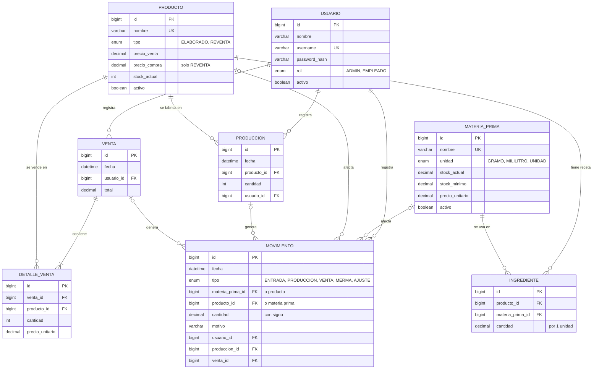

# Modelo entidad-relación - Horneo

Generado a partir de `backend/src/main/resources/db/migration/V1__crear_tablas.sql`.
GitHub dibuja el diagrama automáticamente. Para exportarlo como imagen: copiar el bloque en https://mermaid.live

## Cómo leer las relaciones

| Símbolo | Significado |
|---|---|
| `\|\|--o{` | uno a muchos (cero o más) |
| `\|\|--\|{` | uno a muchos (al menos uno): una venta siempre tiene al menos una línea |
| `\|o--o{` | opcional: un movimiento puede no tener materia prima (si es de producto) |
